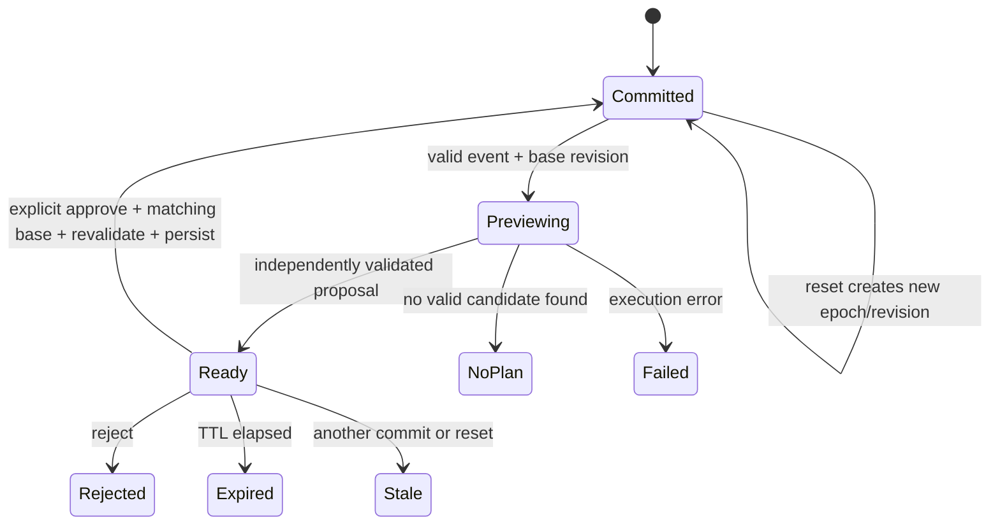

# DispatchIQ operational API contract v1

Proposed contract, frozen for the two implementation handoffs. These endpoints do not exist in the audited repository. API schema changes belong to Developer 1 and require Developer 2 acknowledgement. Research types in `dispatchiq/` retain their original semantics.

## Common conventions

- JSON over `/api`; identifiers are nonempty opaque strings. Never use array position as an ID.
- Simulated date `2026-10-11`, timezone `America/New_York`; all schedule times are integer **minutes after local midnight** within the scenario day. Do not send ISO timestamps for assignment times. Proposal expiry uses UTC ISO timestamps because it concerns real elapsed time.
- Durations/travel/capacity are integer minutes; coordinates/distances use km. Operational travel is `ceil(2 * (abs(dx) + abs(dy)))`. Legacy float arithmetic is unchanged.
- `location: {x_km, y_km, latitude, longitude}`. Grid values are finite nonnegative numbers. Latitude/longitude are both null for the existing synthetic grid, or both present/valid in a future geographical fixture. Do not infer geographic coordinates from the grid. Map labels disclose synthetic locations.
- Skills are normalized strings; `required_skills` is a nonempty unique list; eligibility requires a subset of technician skills.
- Strict booleans and integers; reject NaN/infinity, negative durations, malformed IDs, unknown enum values, duplicates, or additional unsupported event fields. Clients send typed data, never code.
- Each committed snapshot has `scenario_id`, `scenario_epoch` (UUID), and integer `revision`. Epoch changes on reset; revision increases on every successful commit/reset. Proposal base state contains all three. All GET collections return this metadata for consistency.
- Baseline/diff/metrics use explicit assignment intervals, not route order alone. All assignments include contiguous zero-based `sequence` within each technician route. Completed and in-progress assignments remain present.

## Models

| Model | Required fields and meaning |
|---|---|
| Technician | `id`, `name`, `skills: string[]`, `location`, `shift_start_min`, `shift_end_min`, `max_overtime_min` (default 0), `max_service_min`, `availability: available\|unavailable`, `assigned_job_ids: string[]` derived from schedule |
| Job | `id`, `customer: {id,name,site_name}`, `location`, `required_skills`, `priority: 1\|2\|3\|5`, `duration_min`, `earliest_start_min`, `latest_start_min`, `window_end_min`, `soft_promised_start_min: int\|null`, `deadline_start_min: int\|null`, `release_min`, `emergency: bool`, `status: scheduled\|completed\|in_progress\|unassigned\|cancelled`, `locked: bool` |
| Assignment | `job_id`, `technician_id`, `sequence`, `start_min`, `end_min`, `travel_min` (incoming travel), `frozen: bool`; status comes from the referenced job |
| Schedule | `assignments: Assignment[]`, `unassigned_job_ids: string[]`; every noncancelled job accounted for exactly once |
| Validation | `valid: bool`, `violations: {code,job_id?,technician_id?,message}[]`; violations empty if valid |
| Snapshot | `schema_version: "1"`, `scenario_id`, `scenario_epoch`, `revision`, `date`, `timezone`, `now_min`, `travel_model`, `technicians`, `jobs`, `schedule`, `validation`, `metrics`, `events` |
| Change | `job_id`, `before: {technician_id,start_min,end_min}\|null`, `after: same\|null`, `kind: added\|reassigned\|shifted\|unassigned`, `forced: bool`, `reason_code`, `explanation`, `evidence_candidate_id: string\|null` |
| Candidate evidence | `id`, `technician_id`, `insertion_position`, `eligible: bool`, `valid: bool`, `reasons: string[]`, `ranking: Ranking\|null`, `emergency_start_min: int\|null` |
| Ranking | ordered fields `unassigned_existing`, `voluntary_reassignments`, `changed_existing_jobs`, `absolute_start_shift_min`, `emergency_response_min`, `added_travel_min`, `overtime_min` |
| Proposal | `proposal_id`, base metadata, `status`, `event`, `proposed_snapshot: Snapshot\|null`, `changes`, `validation`, `candidates`, `selected_candidate_id: string\|null`, `comparison`, `runtime_ms`, `search`, `expires_at_utc`, `explanation` |

An operational hard window requires start ≥ earliest, start ≤ latest, and end ≤ window_end. `deadline_start_min` is a separate emergency response deadline, not completion deadline. Soft promised time generates measured SLA lateness but does not waive hard windows. `end_min = start_min + duration_min`. Service capacity counts all service minutes for the day, including frozen work. Overtime must be explicitly authorized; zero by default. An in-progress job already assigned to a newly unavailable tech is finished; no further jobs may be assigned to that technician.

Status is derived from simulated time unless cancelled/unassigned: `end <= now` is completed; `start <= now < end` is in progress; otherwise scheduled. All completed/in-progress jobs are frozen. Additional locked future jobs preserve owner/start/end. Event time equals `now_min`; the MVP does not advance the simulation clock between previews. Replanning may delay flexible starts within hard windows but cannot move new work into the past.

## Metrics and scope

`Metrics` contains `scope: "future_from_now"`, `travel_min`, `unassigned_jobs`, `soft_sla_violations`, `soft_sla_lateness_min`, `hard_constraint_violations`, `overtime_min`, and `emergencies: [{job_id,response_min,deadline_met}]`.

Committed/proposed travel compares only route edges after the same snapshot's `now_min`, using free-at/location after the frozen prefix. Report initial baseline metrics separately if displaying whole-day totals. Hard violations must be zero for success. Emergency response is start minus release, separately per emergency; use null when no emergency is assigned, never zero to imply instantaneous service.

Diff metrics: `forced_reassignments`, `voluntary_reassignments`, `changed_existing_jobs` (unique IDs whose owner or start changes), `start_changed_jobs`, `absolute_start_shift_min`, `new_jobs`, `newly_unassigned_jobs`. New emergency assignment is counted in `new_jobs`, not existing-job disruption. A route change originating from sickness counts in forced reassignments. Metrics are computed from schedules, never accepted from a client or copied from a legacy checker with different scope.

## Endpoints

| Method/path | Request | Response / behavior |
|---|---|---|
| GET `/api/health` | none | `{status:"ok",schema_version:"1",optimizer:"feasible_insertion",state_ready:true}` |
| GET `/api/scenario` | none | Full committed Snapshot; initial load and coherent refresh |
| GET `/api/technicians` | none | metadata + `{technicians:[...]}` |
| GET `/api/jobs` | none | metadata + `{jobs:[...]}` |
| GET `/api/schedule` | none | metadata + `{schedule,validation}` |
| GET `/api/metrics` | none | metadata + `{metrics}` |
| GET `/api/research/latest` | none | Read-only summary of saved research runs in `runs/*.json`, newest first: `{runs:[{id,name,mode,team,agents,start,rounds_completed,rounds_accepted,baseline,references,champion:{dev_cost,val_cost,val},curve[],proposer_tokens_total,critic_tokens_total,lessons,strategies}],latest_id,heldout,skipped[]}`. Parses files only; never returns or executes policy code. Research data, separate from the operational snapshot |
| POST `/api/events/parse` | base metadata + `text` (1–2000 chars) | ParseResponse (below). Turns dispatcher free text into an event for preview; never runs the optimizer, never changes state |
| POST `/api/events/preview` | base metadata + `event` + `strategy: "stable_insertion"\|"first_feasible"` | Proposal, with committed state unchanged |
| POST `/api/optimize` | base metadata + `strategy` | Proposal for current committed jobs without introducing an event; same lifecycle/validator as preview |
| POST `/api/events/commit` | base metadata + `proposal_id` | Full committed Snapshot, revision incremented once; atomic event + schedule commit |
| POST `/api/events/reject` | base metadata + `proposal_id` | `{proposal_id,status:"rejected",revision}`; committed state unchanged |
| POST `/api/reset` | base metadata | Fresh fixture Snapshot; increment revision, create new epoch, invalidate old proposals |

`base metadata` fields are `scenario_id`, `scenario_epoch`, `base_revision`. Do not add a mandatory request ID or authentication infrastructure for the local demo. The store prevents proposal reuse; replayed commits return a typed conflict rather than another revision.

P0 event: `{"type":"emergency","at_min":690,"job":JobInput}`. `JobInput` includes every Job field except derived status; `emergency` must be true, priority 5, release equal event time, unique new ID, locked false. Technician-unavailable P1 event: `{"type":"technician_unavailable","at_min":690,"technician_id":"T03"}`. There is no delete/reset-through-event or arbitrary policy-code event. Unknown event kinds return 422.

Synchronous preview is sufficient for this scale: client marks pending until response. Server `status` is `ready`, `no_feasible_plan`, or `failed`. `ready` requires a nonnull independently valid proposed snapshot, all emergencies assigned within deadline, and no silent existing-job drop. Do not introduce fake polling endpoints. Add background jobs only if actual measured runtime makes them necessary.

`search: {termination:"completed"|"budget_exhausted"|"error", candidates_evaluated:int, feasibility_proven_impossible:bool}` describes search scope. `no_feasible_plan` with `feasibility_proven_impossible:false` means the chosen bounded heuristic found no solution. A missing required skill can establish a necessary-condition impossibility; failed insertion alone cannot.

`comparison` is a list of `{strategy,status,metrics:Metrics|null,diff_metrics:DiffMetrics|null,runtime_ms,validation}` computed from identical post-event inputs. An unexecuted comparator is omitted, never given fabricated values. If a comparator finds no valid schedule, metrics are null and its validation/reason visible. Stability claims refer only to actual evaluated candidates.

## Event intake from free text (additive, v1)

`POST /api/events/parse` is optional and needs a server-side LLM (`LLM_BASE_URL`, `LLM_API_KEY`, `LLM_MODEL`; `FALLBACK_1_*`/`FALLBACK_2_*` tried in order). Keys never reach the client. The response is a suggestion: the client shows it, then sends `event` unchanged to `/api/events/preview`. Approval still goes through the normal proposal lifecycle.

`ParseResponse`: `scenario_id`, `scenario_epoch`, `base_revision`, `status: "ready"|"needs_input"`, `event: Event|null`, `missing_fields: string[]`, `issues: {field,message}[]`, `question: string|null`.

- `ready`: `event` is a complete `EmergencyEvent` or `UnavailableEvent` that passed the same Pydantic models as preview. `missing_fields`/`issues` are empty and `question` is null.
- `needs_input`: `event` is null. `missing_fields` lists what the text did not state, `issues` lists stated values that failed validation, and `question` is one short question to ask the dispatcher. Resend with the original text plus the answer.

The model only extracts what the text states. The server sets every field the contract already fixes, so the model cannot change them: `at_min = release_min = earliest_start_min = now_min`, `priority 5`, `emergency true`, `locked false`, `soft_promised_start_min null`, and a new unused job ID `E01`, `E02`, … with customer ID `C-<job id>`.

An emergency needs these stated in the text, else they are listed as missing: `customer_name`, `site_name`, `x_km`, `y_km` (synthetic grid km), `required_skills`, `duration_min` and `respond_within_min`. `deadline_start_min = latest_start_min = now_min + respond_within_min`. `window_end_min = min(1440, deadline + duration + 120)`, the same rule as the dispatcher form. Skills must be among the current technicians' skills (lower-cased). A technician-unavailable event needs a known `technician_id` that is currently available.

Errors: 409 for stale base metadata (same codes as preview); 422 `INVALID_INPUT` for a malformed request; 503 `LLM_NOT_CONFIGURED` when no provider is set; 503 `LLM_FAILED` when every provider fails or returns no usable JSON. No error changes committed state.

```json
{"scenario_id":"demo-v1","scenario_epoch":"11111111-1111-4111-8111-111111111111","base_revision":0,
 "text":"No heat at Civic Clinic plant room, 4 km east 2 km north, 45 minute job, someone must start within 40 minutes"}
```

## Example preview request

Illustrative values for one technician/one routine job below; this is **not** an existing API response, measured benchmark, or the final 10/25 fixture.

```json
{
  "scenario_id": "demo-v1",
  "scenario_epoch": "11111111-1111-4111-8111-111111111111",
  "base_revision": 0,
  "strategy": "stable_insertion",
  "event": {
    "type": "emergency",
    "at_min": 690,
    "job": {
      "id": "E01",
      "customer": {"id":"C99","name":"Civic Clinic","site_name":"Plant room"},
      "location": {"x_km":2,"y_km":1,"latitude":null,"longitude":null},
      "required_skills": ["hvac"],
      "priority": 5,
      "duration_min": 15,
      "earliest_start_min": 690,
      "latest_start_min": 720,
      "window_end_min": 750,
      "soft_promised_start_min": null,
      "deadline_start_min": 720,
      "release_min": 690,
      "emergency": true,
      "locked": false
    }
  }
}
```

## Example committed snapshot

Before preview: one tech at `(0,0)` free at 690, routine J01 at `(1,1)`, hard earliest 700, duration 30. Travel is 4 minutes and baseline routine start is 700. The production fixture has ten techs and twenty-five jobs; this abbreviated complete schema example keeps arithmetic inspectable.

```json
{
  "schema_version":"1",
  "scenario_id":"demo-v1",
  "scenario_epoch":"11111111-1111-4111-8111-111111111111",
  "revision":0,
  "date":"2026-10-11",
  "timezone":"America/New_York",
  "now_min":690,
  "travel_model":{"type":"manhattan_grid","min_per_km":2,"rounding":"ceil","synthetic":true},
  "technicians":[{
    "id":"T00","name":"Mike","skills":["hvac"],
    "location":{"x_km":0,"y_km":0,"latitude":null,"longitude":null},
    "shift_start_min":480,"shift_end_min":1020,"max_overtime_min":0,
    "max_service_min":480,"availability":"available","assigned_job_ids":["J01"]
  }],
  "jobs":[{
    "id":"J01","customer":{"id":"C01","name":"Taylor","site_name":"Residence"},
    "location":{"x_km":1,"y_km":1,"latitude":null,"longitude":null},
    "required_skills":["hvac"],"priority":1,"duration_min":30,
    "earliest_start_min":700,"latest_start_min":760,"window_end_min":800,
    "soft_promised_start_min":null,"deadline_start_min":null,"release_min":0,
    "emergency":false,"status":"scheduled","locked":false
  }],
  "schedule":{
    "assignments":[{"job_id":"J01","technician_id":"T00","sequence":0,
      "start_min":700,"end_min":730,"travel_min":4,"frozen":false}],
    "unassigned_job_ids":[]
  },
  "validation":{"valid":true,"violations":[]},
  "metrics":{"scope":"future_from_now","travel_min":4,"unassigned_jobs":0,
    "soft_sla_violations":0,"soft_sla_lateness_min":0,"hard_constraint_violations":0,
    "overtime_min":0,"emergencies":[]},
  "events":[]
}
```

## Example ready proposal fields

Response excerpt, not a complete Proposal payload. `event` contains the request event and `proposed_snapshot` contains the **full** snapshot schema, including emergency E01. Proposed snapshot retains revision 0 because it is uncommitted. Runtime/expiry/search/comparison must be actual runtime fields; they are deliberately not invented in this example.

```json
{
  "proposal_id":"P01",
  "scenario_id":"demo-v1",
  "scenario_epoch":"11111111-1111-4111-8111-111111111111",
  "base_revision":0,
  "status":"ready",
  "selected_candidate_id":"CAND-T00-0",
  "validation":{"valid":true,"violations":[]},
  "changes":[
    {"job_id":"E01","before":null,
     "after":{"technician_id":"T00","start_min":696,"end_min":711},
     "kind":"added","forced":false,"reason_code":"EMERGENCY_INSERTION",
     "explanation":"Mike has HVAC certification and starts 6 minutes after release, before the 12:00 deadline.",
     "evidence_candidate_id":"CAND-T00-0"},
    {"job_id":"J01","before":{"technician_id":"T00","start_min":700,"end_min":730},
     "after":{"technician_id":"T00","start_min":713,"end_min":743},
     "kind":"shifted","forced":false,"reason_code":"TRAVEL_AFTER_EMERGENCY",
     "explanation":"J01 shifts 13 minutes to fit the emergency and 2 minutes of incoming travel, within its hard window.",
     "evidence_candidate_id":"CAND-T00-0"}
  ],
  "candidates":[{
    "id":"CAND-T00-0","technician_id":"T00","insertion_position":0,
    "eligible":true,"valid":true,"reasons":[],"emergency_start_min":696,
    "ranking":{"unassigned_existing":0,"voluntary_reassignments":0,
      "changed_existing_jobs":1,"absolute_start_shift_min":13,
      "emergency_response_min":6,"added_travel_min":4,"overtime_min":0}
  }]
}
```

Within `proposed_snapshot.schedule`, E01 has sequence 0, travel 6, start/end 696/711; J01 has sequence 1, travel 2, start/end 713/743. Future travel becomes 8, one existing job changes, absolute start shift is 13. The selected-tech list becomes `["E01","J01"]`; E01 is added to proposed jobs with scheduled status. The full event is appended only to the private proposed snapshot until approval. No explanation claims superiority over an unexecuted alternative.

Commit request:

```json
{"scenario_id":"demo-v1","scenario_epoch":"11111111-1111-4111-8111-111111111111","base_revision":0,"proposal_id":"P01"}
```

Successful commit returns full Snapshot revision 1. GET scenario thereafter returns that schedule and event. A second commit using revision 0 returns 409. Reject uses the same body at `/events/reject`. Reset uses base metadata without a proposal ID.

## Errors and lifecycle

Error envelope:

```json
{"error":{"code":"STALE_PROPOSAL","message":"The schedule changed. Preview this event again.","current_revision":1,"details":[]}}
```

- 422 `INVALID_INPUT` for schema violations; standardized FastAPI validation errors transformed to this envelope.
- 404 `UNKNOWN_PROPOSAL`/`UNKNOWN_TECHNICIAN`/`UNKNOWN_JOB` for missing entities after request syntax validates.
- 409 `STALE_PROPOSAL`, `PROPOSAL_CONSUMED`, `PROPOSAL_REJECTED`, or `SCENARIO_CHANGED` for lifecycle/revision mismatches.
- 410 `PROPOSAL_EXPIRED` after configurable TTL (recommended 15 minutes real elapsed time).
- 503 `OPTIMIZER_FAILED` or `STATE_WRITE_FAILED` for infrastructure/runtime errors; no committed-state mutation.
- 503 `LLM_NOT_CONFIGURED` or `LLM_FAILED` from `/api/events/parse` only; the event form and preview still work.
- A valid event with no feasible candidate returns 200 Proposal `status:"no_feasible_plan"`, null proposed snapshot, explicit reasons, search termination, and no approve action. This is a domain result, not malformed input. Unexpected failures may return 503 rather than a domain proposal.

State transitions:



Commit/reject/reset are serialized under a store lock. Preview snapshots under lock, computes privately, then verifies base state before registering a ready proposal. It can return a stale conflict if another event committed during computation. Persist committed state atomically before acknowledging success; never partially commit a job/event before its schedule. Invalidate sibling proposals after successful commit/reset. No implicit browser toggle or page refresh can approve a proposal.
