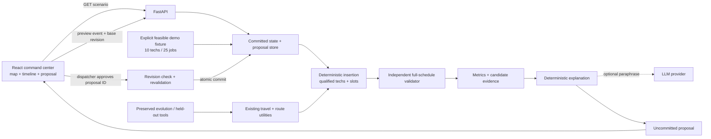

# DispatchIQ repository assessment and six-hour execution plan

Planning snapshot: 2026-10-11, America/New_York. Repository: https://github.com/dev4-gpt/DispatchIQ.git. Audited `main` at `0e8fbc48b1d86492a1693ddf3ef63714aca36382`; clone and subsequent `git pull --ff-only` succeeded. This document describes proposed work, not implemented features.

## Decision

Keep the Python simulator, deterministic data, route evaluator, insertion policies, and research evaluation pipeline. Add a small FastAPI operational service and a React/TypeScript/Vite command center. Start with validated, disruption-aware feasible insertion; defer OR-Tools and live LLM dependencies. Preserve the Streamlit research view rather than deleting it. Introduce strict operational contracts without silently changing the existing benchmark's soft-window semantics.

The critical work is stricter scheduling validation and preview/approval state, followed by a cohesive map/timeline UI. The repository already has useful scheduling logic, but it does not yet implement the requested dispatch operating system.

## A. Repository assessment

Inspected README, RUNBOOK, MARKET, all application/package/test source files, requirements, ignore rules, and the held-out hash. No applicable AGENTS.md, frontend manifest, dependency lockfile, HTTP backend, database schema, CI workflow, deployment manifest, or reusable web design system was found in this checkout.

| Component | Existing implementation | Working status | Keep / Modify / Replace | Reason |
|---|---|---|---|---|
| Frontend | `app.py`, Streamlit + pandas + Plotly timelines | Browser launches; fresh clone stops at missing `runs/latest.json` | Keep research view; add operations frontend | No approval flow, interactive map, technician/job inspector, or committed schedule |
| Backend services | Python CLI and imported package only | No HTTP endpoints | Add FastAPI adapter | Expose existing scheduling code through stable callable APIs |
| Data model | `dispatchiq/model.py`: Tech, Job, Day, Disruption, Stop, RouteResult | Importable; route arithmetic test passes | Keep; operational schema adapter | Single required skill, synthetic grid coordinates, no customer/status/capacity/revision |
| Travel | Manhattan city-grid distance, 2 minutes/km | Deterministic; arithmetic verified | Keep and disclose | Reliable offline; no roads, traffic, latitude/longitude, or directions service |
| Scenario generator | `generator.py`: 8–12 techs, 30–50 routine jobs, sick techs and emergencies | Determinism/split/hash test passes | Keep unchanged; add separate 10/25 fixture | Existing generated baselines may be late or unassigned; do not alter published held-out data |
| Morning scheduling | `simulate.morning_plan`, priority-first cheapest insertion | Runs; baseline windows are soft, some jobs omitted | Reuse idea; strict operational constructor | A baseline must independently satisfy hard operational constraints |
| Frozen work | `simulate.freeze/replan_state` | Frozen jobs excluded from replanning; test passes | Keep; extend validation | Need explicit completed/in-progress statuses and full-schedule immutability checks |
| Dispatcher baseline | `policies/naive.py`: nearest eligible tech, emergencies first, routine-job bumping | Direct trusted calls work on dev seeds 0–9; subprocess fails on Windows | Keep for legacy comparison | Not hard-window/deadline aware; not acceptable as unchecked operational output |
| Insertion reference | `policies/insertion.py`: enumerate technician/position; minimize cost | Direct calls work under legacy checker | Keep and adapt in operational optimizer | Valuable zero-churn seed; may drop routines and accept late emergencies |
| Local search | `policies/parametric.py`: resequence/regret/relocate knobs | Source inspected; not separately runtime benchmarked | Keep research implementation; defer operational search | Existing cost objective is different from proposed stability objective |
| Independent checker | `simulate.check` | Skills, duplicates, sickness, emergency presence and overtime checked | Keep legacy; add strict validator | Customer latest start and emergency deadlines are penalties, not hard rules |
| Policy runner | `sandbox.py`: isolated Python subprocess, timeout, Unix memory cap | Fails on Windows: missing `resource` | Repair portability for research; do not use arbitrary code in operations API | Process separation is not a security sandbox |
| AI integration | `proposers.py`: OpenAI-compatible providers, fallbacks, strategy prompts | Stub extraction/token test reaches evaluation; live providers unconfigured | Preserve optional research feature | No live AI verification; online code generation must not block dispatch |
| Evolution | `evolve.py`: concurrent candidate generation, dev selection, validation promotion | Inspected; blocked by runner on Windows | Keep; repair later | Existing research pipeline has value; track emphasis differs from new brief |
| Held-out evaluation | `heldout.py`, committed hash, disjoint seed splits | Hash verified; final evaluation deliberately not run | Protect unchanged | Do not tune on held-out days or repeat a final assessment for UI development |
| Persistence | Local `runs/*.json`; optional MongoDB round log | No run artifacts present; Mongo unconfigured | Keep research logs; add small operational state file | No committed operational schedule/proposals today |
| Tests | Eight pytest tests | 6 pass, 2 fail on Windows | Keep; add meaningful operational cases | Some sandbox negative tests pass only because runner cannot start |
| Dependencies | Unpinned `openai`, `streamlit`, `plotly`, `pandas`, `pymongo`, `pytest` | Global core imports work; clean installation assessed separately | Pin validated environment; isolate venv | No lockfile; global environment has unrelated conflicts |
| Deployment | Manual CLI/Streamlit instructions | Local empty state verified; remote deployment unverified | Add local two-process setup; single-service static build if time | No containers or external database required |
| Documentation | README/MARKET/RUNBOOK describe Track 1 and three roles | Does not match new Track 1B/two-developer brief | Add this plan; update public docs during implementation | Use requested two-person product scope; verify event submission rules independently |

### Verified runtime and diagnostic findings

- Host Python 3.13.5, Node 24.14.0; `npm.cmd --version` works. PowerShell blocks `npm.ps1`, so use `npm.cmd`/`npx.cmd` without changing machine execution policy.
- `python -m pytest -q`: **6 passed, 2 failed**. Both failures originate in `sandbox.RUNNER` importing Unix-only `resource`.
- `python -m compileall -q app.py evolve.py heldout.py dispatchiq tests`: passed. Compilation is not evidence of a working full demo.
- Global `pip check` reports unrelated Conda/CrewAI/telemetry conflicts. Do not repair the user's global environment; use the project `.venv`.
- A clean `.venv` installation of all six declared dependencies succeeded. Its `pip check` reports no broken requirements; its pytest run independently reproduces **6 passed, 2 failed** with the same Windows `resource` error. Resolved versions are saved in [requirements-resolved.txt](audit/requirements-resolved.txt); this records the audit environment, not a guarantee for every platform or populated UI compatibility.
- Streamlit launched on `127.0.0.1:8501`. Actual Playwright Chromium inspection captured [desktop](audit/existing-app-1440.png) and [mobile](audit/existing-app-390.png). The page stops at “No run yet.” The populated timeline and full disruption interaction remain unverified.
- The clean environment's Streamlit AppTest also confirms the same warning with zero app exceptions. Its first 3-second cold-import timeout passed on retry with a 30-second allowance; this tests the empty state only.
- Existing local JavaScript Playwright and Chromium were successfully used; Python Playwright is absent. The borrowed module lives outside this checkout and is not a portable project dependency; Developer 2 must install a local browser-test dependency.
- Trusted built-in policies were called directly, with deep-copied identical post-event states, on **dev seeds 0–9 only**. All 20 returned schedules pass the legacy checker. These diagnostic calls bypass the broken subprocess runner; this is not a repaired end-to-end pipeline or an operational feasibility benchmark.
- Seed 0: 11 techs, 42 routine jobs, 40 assigned initially, **7 late initially**. Post-event naive cost 1618.12, insertion cost 1440.19; insertion increases travel from 444.70 to 462.06 minutes and unassigned work from 2 to 3. Lower weighted cost does not mean every metric improves.
- Seed 2: naive has two emergency starts past their deadlines; insertion has one. Both are marked feasible by the current checker. A tiny independent probe also accepts an emergency **9 minutes late**.
- A malformed nested-list job identifier raises `TypeError` instead of returning a controlled invalid-input result.
- Exact per-case values and algorithm-only timing are in [diagnostics.json](audit/diagnostics.json). These sub-millisecond timings exclude API, validation, serialization, browser, and subprocess overhead; they are not demo latency claims.
- The held-out generator hash matches the committed value. No `heldout.py` final scoring, LLM request, or MongoDB connection was performed. README historical benchmark claims were not reproduced.

### What works, what needs repair, and what is missing

Immediately reusable: travel arithmetic, route sequencing, skill filtering, priority ordering, frozen-state extraction, insertion structure, cost decomposition, seeded splits, and deterministic fallback ideas. Preserve these and all published held-out artifacts.

Partially functional: research UI, subprocess evaluation, AI proposal pipeline, and policy comparison. Repair Windows startup and error handling before relying on them. In `app.py`, an evaluation failure leaves `per_seed` empty and `per_seed[seed]` can raise; present an explicit unavailable result instead.

Missing: HTTP API, strict hard-window validator, current operational schedule, proposal IDs/revisions, human commit/reject, explicit execution statuses, customer details, multi-skill requirements, capacity, event history, change timing metrics, comparative evidence, offline interactive map, responsive operations UI, browser workflow tests, and reproducible dependency locks.

Defer: live policy evolution, MongoDB, advanced local search, live GPS, commercial routing APIs, real traffic, multi-tenant authentication, notifications, integrations, maps requiring paid accounts, and new agent frameworks. No functioning source needs deletion in the planning phase.

### Security and correctness issues to repair within scope

1. `python -I`, a small environment, timeout, and memory limits do not restrict filesystem or network access. Generated policies can still access the machine. The operational API accepts events and identifiers, **never Python code**. If arbitrary policy evolution is later exposed, require actual isolation in a separate environment; do not advertise this runner as secure.
2. `evaluate` assumes JSON result shape and uses `zip`, which can silently omit missing results. Validate one result per requested seed, every result's shape, and malformed job IDs; report failure without throwing.
3. Validation promotion in `evolve.py` checks mean cost, but not explicitly `best_val.infeasible == 0`. Add that guard before making a research champion acceptance claim.
4. Shared RNG calls inside worker threads make seed-to-agent proposal assignment dependent on scheduling. Precompute per-agent seeds if reproducible evolution is pursued.
5. Existing overtime allowance is 90 minutes; requested strict shifts cannot silently inherit this. Operational fixtures default overtime to zero and use an explicit capacity limit.
6. Existing `latest` means latest **start**, not service completion. Introduce separate operational window end and deadline fields; do not reinterpret legacy data without documenting the change.
7. Existing `moved` excludes moves from sick techs and measures owner changes only. Expose forced reassignments, voluntary reassignments, timing changes, and total changed jobs separately.
8. Raw provider/Mongo exception strings can contain connection information. Keep API keys server-side, redact logs, and expose concise typed errors.

## B. Final architecture and practical alternatives

| Area | Choice | Why within six hours | Rejected/deferred alternative and failure mode |
|---|---|---|---|
| Backend | FastAPI + Pydantic, one process | Small typed wrapper around Python logic; OpenAPI; clear frontend contract | Streamlit alone lacks desired API/client separation; Flask offers little reuse benefit; Node backend would duplicate Python scheduling |
| Scheduling | Deterministic exhaustive feasible insertion over qualified techs/slots, stability ranking | Small 10/25 problem; inspectable alternatives; easy offline validation; existing code reusable | Full OR-Tools migration risks constraint/installation/integration delay |
| OR-Tools Routing | P2, if measured need remains | Suited to routing with travel/time dimensions | Frozen prefixes and disruption penalties need careful modeling; solver setup would compete with workflow delivery ([official VRPTW documentation](https://developers.google.com/optimization/routing/vrptw)) |
| CP-SAT | P2 | Useful for interval/capacity scheduling with explicit logical constraints | Travel sequence modeling and lexicographic objectives add work; integer modeling needs care ([official solver documentation](https://developers.google.com/optimization/cp/cp_solver)) |
| Local search | P1, bounded relocate/swap after valid insertion | Can improve residual infeasibility/disruption | Never let unbounded search or unchecked moves hold the workflow hostage |
| Frontend | React + TypeScript + Vite | Direct component ownership, fast local dev, typed API; justified new UI alongside research app | Next.js adds server/rendering conventions with no existing Next code to reuse; vanilla JS makes dense state harder to maintain ([Vite guide](https://vite.dev/guide/)) |
| Styling/components | Tailwind + small shadcn/ui selection + Lucide | Consistent accessible controls; components checked into app | Several overlapping libraries create dependency/style conflicts; no premium design dependency |
| Timeline | CSS grid/custom React board | Transparent before/after bars and click behavior for ten rows | Large Gantt library integration/license complexity |
| Map | Leaflet `CRS.Simple` with local synthetic city schematic | Matches existing km grid; clickable markers/routes; no tiles/network required | MapLibre vector style/tile setup unnecessary for grid data; real geographical layer is P1 ([Leaflet reference](https://leafletjs.com/reference.html)) |
| State | React reducer + typed fetch client | One committed snapshot, one proposal, selection, load/error state | Zustand unnecessary initially; TanStack Query P1 if cache/refetch needs grow |
| Charts | Small metric comparisons; Recharts only if needed | Actual before/after values matter more than a decorative chart | Existing Plotly stays in Streamlit; do not pull two chart systems into React |
| Persistence | In-memory current snapshot + atomic local JSON save; one backend worker | Simple reset/replay; no network required | Mongo/SQL deployment complexity; SQLite only if genuine transactional multi-session needs arise |
| Explanations | Deterministic structured evidence; optional LLM paraphrase | Correct explanations work offline | LLM scheduling or invented comparison claims are unacceptable |

All these are recommendations based on the audited project, not claims that the new stack has been implemented. Strict validator and APIs must ship before visual refinement. Single-process locking protects preview/commit/reset; deployment must not start multiple stateful workers. Local persistence contains synthetic data only in the MVP.

Proposed files:

```text
backend/
  app.py             # endpoints, CORS or frontend proxy, health
  schemas.py         # strict Pydantic operational models
  scenario.py        # explicit feasible 10-technician/25-job fixture
  adapters.py        # existing grid travel/model integration
  optimizer.py       # insertion, candidate evidence, first-fit comparator
  validator.py       # independently inspect explicit full schedules
  metrics.py         # same-scope before/after values and change accounting
  explanations.py    # evidence -> deterministic text
  store.py           # revisions, proposals, lock, atomic state persistence
  requirements.txt
  tests/
frontend/
  src/api/{types.ts,client.ts}
  src/state/dispatch.ts
  src/components/{OperationsShell,RouteMap,ScheduleBoard,JobInspector,
                  TechnicianList,ProposalPanel,MetricsStrip,ScenarioControls}.tsx
  src/styles/tokens.css
  tests/dispatch.spec.ts
  package.json, package-lock.json, vite.config.ts, playwright.config.ts
docs/CONTRACTS.md, docs/EXECUTION_PLAN.md
dispatchiq/, app.py, evolve.py, heldout.py  # preserved research code
```

## C. Architecture and event flow



Preview never mutates committed jobs, technician availability, assignments, or revision. Approval commits event and schedule together. Reject removes the proposal. Reset reloads the fixture and invalidates every earlier proposal. Failed AI or map tiles cannot affect schedule validation/approval.

## D. Technical contracts

The normative contract is [CONTRACTS.md](CONTRACTS.md), including types, example payloads, endpoint semantics, metrics, errors, and state transitions. Developer 1 owns contract changes; Developer 2 consumes them. Freeze v1 before implementation branches diverge. Initial frontend fixtures must be explicitly marked as development fixtures and removed from the real demo path once the API works.

## E. Two-developer ownership

| Component | Developer 1 — backend/optimization | Developer 2 — frontend/integration |
|---|---|---|
| `backend/**`, backend tests | Sole owner | Call APIs; report defects |
| `dispatchiq/**`, `tests/test_dispatchiq.py` | Sole owner; preserve legacy semantics | Read only |
| `evolve.py`, `heldout.py`, legacy dependencies | Sole owner; defer noncritical work | Read only |
| `frontend/**`, lockfile, browser tests, screenshots | Read only; provide data/evidence | Sole owner |
| `docs/CONTRACTS.md`, generated OpenAPI | Owner; send revision + example before changes | Review and synchronize types |
| Root `.gitignore`, README/startup instructions | Owner; coordinate shared edits | Supply frontend instructions for owner to merge |
| Legacy `app.py` | Preserve; only repair evaluator errors if needed | UI fallback polish only by explicit coordination |
| Demo fixture IDs/time/coordinates | Owner | Consume unchanged |
| Acceptance rehearsal | Validate schedule/evidence | Drive browser and presentation |

Exactly two human development streams; no additional agent framework is required. Separate coding-agent sessions may use the handoff prompts, with ownership restrictions enforced. Do not edit a file owned by the other developer to work around an integration mismatch.

## F. Six-hour execution schedule

The existing audit saves some Hour 1 effort, but strict operational state/API/UI are still substantial work. Treat six hours as twelve person-hours; cut optional work at each gate.

| Hour | Developer 1 tasks / files | Developer 2 tasks / files | Output and integration gate | Dependencies, risk, and delayed fallback |
|---|---|---|---|---|
| 1 | Read audit; freeze contracts; `backend/schemas.py`, `scenario.py`, `adapters.py`, validator skeleton; decide Windows runner repair approach | Verify MCP/component discovery; initialize `frontend/`; tokens, shell, API types/client; install local Playwright | Agree IDs/minutes/coordinates/revisions; baseline fixture validates; frontend starts; API shapes frozen | Depends on isolated deps. Cap MCP setup at 10 min; CLI components if unavailable. Avoid OR-Tools |
| 2 | `backend/app.py`, `store.py`, `validator.py`; GET scenario/schedule/health; persist/reset baseline | Shell, technician list, map, timeline render actual API snapshot | First vertical slice: 10 techs/25 jobs shown, valid baseline, no `runs/latest.json` dependency | Depends on schema and fixture. If map integration delays, interactive local schematic first; remove optional navigation pages |
| 3 | `optimizer.py`, preview/commit/reject; enumerate insertions; validate full proposed schedule; stale commit tests | Emergency control, preview loading, changed bars, proposal inspector, approval/reject/reset | Browser emergency -> validated preview -> approve; preview leaves revision/state unchanged | Depends on baseline validator/store. If replanning breadth delays, only single emergency; no sickness yet |
| 4 | `metrics.py`, `explanations.py`; candidate evidence, stability ranking, same-event first-fit comparison; sickness only if gate passed | Map selection linkage, before/proposed switch, readable changes, keyboard/error states; desktop screenshot iteration | Real change counts, travel/SLA/response, grounded explanation; five specific visual deficiencies fixed if present | Depends on real diff/evidence. Skip LLM and local search; remove complex charts rather than fabricate data |
| 5 | Adversarial constraints/API tests; timeout/no-plan behavior; reset determinism; optional outage scenario; lock/persistence errors | Playwright full workflow, stale proposal, infeasible event, reset; 1440/1024/390 checks; screenshot repeat | Both machines run all P0; no invalid success; same-scope measured comparison recorded | Dependencies: stable API, local browsers. Fix failures before P1; deployment optional; keep local demo ready |
| 6 | Freeze code, pin deps, start/run docs; review measured evidence and known limitations | Final UI rehearsal, backup screenshots/video, 90-second flow; verify submission assets | Stable tagged demo; reproducible install/reset/replay; explicit synthetic travel and solver limits | No major features. Revert failing optional change; if remote fails demo local; confirm Track 1B rules separately |

By minute 120, real API data must be visible. By minute 180, approval must update the real committed schedule. If either checkpoint misses by 20 minutes, cut sickness, LLM, charts, route animation, advanced search, and remote hosting before cutting validation or human approval.

## G. Frontend design specification and MCP status

Direction: a calm enterprise dispatch room. Light stone canvas `#F5F6F8`, white panels, dark navy text `#17212F`, slate muted labels, blue selected/committed state, amber proposed displacement, red emergency/error, green validated/complete. No decorative neon/glow. Use local system fonts initially; bundle a chosen font if used. 4/8px spacing rhythm, 12px panel radius, 1px quiet borders. Body 14px, metadata 12px, panel heading 16px; tabular numerals for time and metrics.

Desktop 1440×900: 200px navigation rail, 64px operational header, flexible central map/board region, 340px contextual inspector. Map gets about 40% of vertical workspace and timeline about 60%; neither should dominate with empty space. Timeline shows all ten tech names, certification chips, 08:00–17:00 axis, now line, lock icons for frozen work, and scannable job bars. Small metric strip follows proposal context. Sidebar items focus/select actual panels; defer empty standalone pages.

Header: DispatchIQ, simulated date/time, available tech count, jobs in progress, emergency count, backend/optimizer state, Reset and Introduce emergency. Inspector: selected job/customer/skills/window, eligible technician reasons, proposed action, before/after start, candidate comparison evidence, validation outcome, Approve and Reject. Only show an optimization spinner while a real request is pending.

Map uses original synthetic grid coordinates and local schematic, with an explicit “Synthetic city · estimated travel” label. Tech markers and customer jobs are distinct; selected route connects ordered jobs. Lines represent estimated route order, not actual road directions. Never convert arbitrary grid coordinates into purported customer addresses or pretend live GPS. A real lat/lng fixture and Leaflet road-tile layer are P1, with the same offline schematic retained.

Interactions: select tech -> highlight row/route; select map or timeline job -> inspector; emergency -> preview; show evaluated alternatives/rejections; changed assignments highlighted with text/icon as well as color; baseline/committed/proposed view toggle; approve real proposal; reject leaves snapshot intact; reset restores original fixture. Expose unassigned work and infeasibility clearly. Disable approval for stale/invalid/no-plan proposals. Loading/error/retry states are localized and preserve the committed schedule.

At 1024px collapse sidebar and use inspector drawer. At 390px use map/timeline tabs and stacked inspector; timeline may horizontally scroll in its own region, never the entire page. Support keyboard focus, Escape to close inspector, descriptive controls, contrast, non-color change indicators, reduced motion, and visible status announcements.

### MCP discovery: verified versus available in theory

| Integration | Evidence/status in this session | Recommendation |
|---|---|---|
| Plugin-management connector | Successful design-provider search returned a Figma plugin | Discovery works; no design access implied |
| GitHub | Git clone and pull verified via Git CLI | CLI sufficient; GitHub connector not needed for local audit |
| shadcn MCP | No shadcn tools exposed in active tool catalog; official docs inspected | Prefer official server if connected and a component query succeeds during implementation; otherwise use official CLI/registry |
| Figma | Plugin search reports `installed: false`; no Figma tools or design reference supplied | Optional only when a real design becomes available; do not make account setup a critical dependency |
| Browser automation | No Playwright MCP tool exposed; existing local JS Playwright successfully launched Chromium and inspected actual app | Local Playwright is verified fallback; add project-local dependency |
| Other exposed app tools | Sites, document control and other app tools visible; not operationally called for this audit | Visibility is not connection/runtime verification; unrelated tools add no scheduling value |

The official [shadcn MCP](https://ui.shadcn.com/docs/mcp) supports registry component search and installation; reading its documentation does **not** establish a session connection. Prefer a coherent selection of Button, Badge, Tabs, Tooltip, Sheet, Dialog, Table, ScrollArea, Select, Skeleton, and Alert. [Official Figma MCP documentation](https://developers.figma.com/docs/figma-mcp-server/) describes design access; no appropriate Figma design is available here. [Playwright](https://playwright.dev/python/docs/intro) provides browser automation; this audit used its JavaScript implementation locally.

### Mandatory visual loop

The actual existing screenshots show five concrete deficiencies: (1) a fresh clone has no usable operational workspace; (2) oversized heading competes with metadata; (3) most desktop area is empty; (4) no technician/job/map/timeline selection exists; (5) the warning provides a CLI instruction instead of a usable baseline/load action. Mobile screenshot is also saved. These findings concern the current empty state, not a claimed review of a populated dashboard.

During implementation, launch real API/frontend, capture 1440×900 and smaller views, inspect alignment/readability/density/colors, record at least five actual deficiencies if present, fix them, and capture again. Run emergency/inspect/compare/approve/reject/reset through browser automation against the live API. Compilation alone cannot satisfy UI acceptance. Save screenshots and defect notes under `frontend/test-results/` or a documented evidence folder.

## H. Optimization and validation design

Operational scenario: explicit deterministic 10 technicians, 25 initially assigned routine jobs, multiple certifications, grid locations, varied windows; now at 11:30. At least one completed and one in-progress job are frozen. Baseline must validate with all 25 accounted for and no hard violation. Place a feasible critical emergency so at least one future start or assignment actually changes. A separate impossible event demonstrates honest failure; do not choose held-out seeds to manufacture a win.

Algorithm:

1. Snapshot the **current committed schedule**, not the morning plan on every event. Freeze completed/in-progress assignments and protect hard commitments.
2. Apply event to a private copy. For an emergency, add one released job; for sickness, remove only that tech's future availability and collect affected jobs, retaining frozen work.
3. Determine eligible techs using availability, required-skills subset, shift/capacity, and locked commitments. Record exclusions with reason codes.
4. For each eligible technician and insertion position, preserve the frozen prefix; propagate travel/wait/start/end times through future jobs. Start with the existing insertion design, adapted to strict schema and constraints.
5. Validate every candidate independently. Disallow dropping existing committed jobs by default. If no insertion fits, use bounded relocations as P1 or return no feasible plan found. Never pretend this proves global infeasibility unless a necessary condition proves it.
6. Rank feasible candidates lexicographically: unscheduled existing work (normally zero), voluntary technician reassignments, number of existing jobs changed in owner or start, total absolute start displacement, emergency response, added travel, overtime. Exclude necessary forced moves from the voluntary count but report them separately. Published ordering makes the tradeoff defensible; this is a heuristic, not novel mathematics.
7. Return winning schedule, selected candidate's evidence, all evaluated option summaries, measured runtime and full validator result. Store an immutable proposal with base revision and expiry.
8. Revalidate and atomically compare revision on commit. Only explicit dispatcher approval changes current state.

Hard constraints: unique known job/tech IDs; every routine job accounted for as assigned or explicitly unassigned; no duplicate assignment; all required skills; technician availability; shift and authorized overtime/capacity; release/earliest; latest-start plus service-window completion; explicit emergency response deadline; travel from previous end/location; no overlap; unchanged frozen owner/start/end; locked commitments; finite integer times and positive durations; assigned emergency mandatory for a ready proposal. Operational max overtime defaults to zero.

An independent validator reads explicit full assignment intervals and original snapshot. It does not trust `route_cost`, candidate feasibility flags, or the optimizer's reported metrics. It may reuse the shared travel estimator, whose arithmetic has separate hand-computed tests, but must independently check every schedule edge. The old checker remains research-only unless its semantics are deliberately versioned.

Soft preferences: fewer owner changes, fewer shifted customers, smaller start changes, faster emergency response, less travel, lower overtime, and fewer soft SLA misses. Hard commitments never become soft just to manufacture a feasible result. If a soft promised start is modeled, keep it separate from a hard latest-start/window-end field.

For each meaningful change, record old/new tech, old/new start/end, forced versus voluntary reason, emergency dependency, and evidence. “Fewer changes than evaluated alternatives” requires actual alternative scores. “Best possible” and “optimal” are prohibited unless independently established by an appropriate solver proof.

Record wall-clock optimization duration with a monotonic clock, separately from end-to-end UI latency. Enforce an execution budget (target ≤2 seconds for 10/25, acceptance measured rather than assumed). If the budget expires, a valid incumbent may be offered with `search_exhausted=false`; otherwise return `no_feasible_plan` with scope/termination information.

## I. Prioritized backlog

| Priority | Work | Acceptance |
|---|---|---|
| P0 | Isolated setup and documented commands | Both developers start app from clean clone |
| P0 | Strict models + feasible 10/25 baseline | Independent validation; all IDs/statuses accounted for |
| P0 | Snapshot API, revisions, atomic preview/commit/reject/reset | Preview unchanged; stale/reset proposals rejected |
| P0 | Feasible emergency insertion and grounded evidence | Real assignment/timing change; deadline met; no invalid success |
| P0 | No-plan and malformed-input handling | Useful error; committed schedule preserved |
| P0 | Integrated map, timeline, inspector, scenario controls | Tech/job selection linked; real API data |
| P0 | Metrics, comparison and explanations | Values computed from same post-event snapshot; scope labeled |
| P0 | Browser/design loop + deterministic replay | Desktop/mobile screenshots; workflow passes twice |
| P1 | Technician-unavailable preview/commit | Frozen work retained, future affected jobs handled explicitly |
| P1 | Bounded relocate/swap | Only independently valid improvements; deterministic budget |
| P1 | Legacy Windows runner/error repair, reproducible research setup | Eight legacy tests genuinely pass; timeout/error paths exercised |
| P1 | Real geographical fixture/optional road tiles | Coordinates genuine for synthetic fixture; offline fallback works |
| P1 | Optional evidence-only LLM paraphrase | No unsupported claims; deterministic fallback |
| P1 | Single-service deployment, persistence restart test | Local demo remains available; secrets never in frontend |
| P2 | OR-Tools, live policy evolution, Mongo logging, external integrations | Only after P0 stability and measured need |

The Windows runner is urgent for preserving the research demo but does not need to sit on the new operations critical path: use trusted built-in operational code rather than generated policy subprocesses. Fixing its platform guard must not be mistaken for securing arbitrary code execution.

## Git and integration strategy

Keep `main` stable. Developer 1 uses `feature/optimization`; Developer 2 uses `feature/operations-ui`. Freeze contract documentation first, then both branch from the same commit. Do not move `dispatchiq/` into `backend/`; an adapter avoids churn. The root Python dependency file belongs to Developer 1; frontend package/lock/config belong to Developer 2.

Merge a working snapshot API and UI slice at Hour 2, emergency slice at Hour 3, evidence/polish at Hour 4, and validation fixes at Hour 5. One developer coordinates merges; pull/rebase only clean work and review conflicts semantically. Contract changes require a short written delta, schema version, example request/response, and acknowledgement before either side renames fields. Document any compatible additions; never silently change time units.

Each merge gate runs relevant backend tests, frontend build, and live browser smoke. Create a demo tag after a full successful rehearsal; avoid late untested merges. Roll back a broken optional feature with `git revert <commit>` after checking dependent commits, or demonstrate from the known-good tag in a separate checkout. Do not force-push shared branches or remove existing working source.

## Risk management and fallbacks

| Risk | Likelihood / impact | Early warning | Prevention | Fallback |
|---|---|---|---|---|
| OR-Tools wheel/setup | Medium / high | Import/install consumes >10 min | Exclude from P0 | Independently validated insertion |
| Invalid constraints | High / critical | Late emergency marked feasible, baseline fails | Strict validator first; hand-computed/adversarial tests | Reject proposal; never show invalid success |
| Travel realism | High / medium | Grid estimate interpreted as road ETA | Visible estimator label, same model across comparisons | Local km schematic; no traffic claims |
| Windows runner | Confirmed / high for research | `ModuleNotFoundError: resource` | Platform-aware runner; real timeout/result-shape tests | Trusted operational policy; preserve research feature as unavailable |
| Dependency conflicts | Medium / high | Unpinned versions/global `pip check` failures | Separate venv/frontend lock; pin validated versions | Retain known working environment/locks |
| Map/network assets | Medium / medium | Tiles/font/icons missing offline | Local schematic, bundled icons/fonts | Schedule board and schematic remain interactive |
| AI limits/outage | High / medium | No key, timeout, 429 | AI optional; bounded request; no API secrets in client | Deterministic evidence text |
| Contract mismatch | Medium / high | API validation errors/undefined UI values | Single owner, frozen types, integration checkpoints | Revert incompatible change, use last agreed v1 |
| Slow search | Low at 10/25 / high | Preview exceeds measured budget | Bounded enumeration/search, monotonic timing | Valid incumbent or explicit no-plan |
| Rendering/accessibility | Medium / high | Clipped bars, unreadable text, hidden controls | Real screenshots at three widths; keyboard test | Collapse inspector, simplify chart/layout |
| Merge conflicts | Medium / high | Both edit config/contracts/root files | Ownership and small frequent merges | Owner resolves with other developer; retest |
| Stale approval/race | Medium / critical | Proposal based on prior revision/reset | Lock + revision compare + revalidation + epoch | Reject 409 and refresh snapshot |
| State write failure | Low / high | Disk permissions/corrupt JSON | Atomic temp/replace; do not acknowledge failed persistence | Keep last valid state; explicit error/reset |
| Deployment failure | Medium / high | Health/static route fails | Local launch and rehearsal first | Demo locally; backup recording |
| No internet | Medium / high | Live provider/tile fetch fails | Core uses local fixture, code, schematic, explanations | Offline local demo |
| MCP/design tool absence | Confirmed for shadcn/Figma here / low | No tools or successful design query | Timebox setup; verify rather than assume | Official component CLI; components already checked in |
| Wrong event track/rules | Unknown / high | Old repo says Track 1, brief says 1B | Verify organizer requirements before submission | Align pitch/assets to confirmed track; do not invent rules |

## J. Integration checklist and demo readiness

Currently runnable commands (repository root, PowerShell):

```powershell
python -m pytest -q
python -m streamlit run app.py --server.headless true --browser.gatherUsageStats false
```

Current limitations: tests fail twice on Windows and Streamlit needs a run JSON to show its research dashboard. Clean setup is `python -m venv .venv` followed by `.\.venv\Scripts\python.exe -m pip install -r requirements.txt`; no activation script is required. A dependency-resolution snapshot is an audit artifact, not a validated cross-platform lock.

Planned commands after modules are implemented (not runnable yet):

```powershell
.\.venv\Scripts\python.exe -m pip install -r backend\requirements.txt
.\.venv\Scripts\python.exe -m pytest backend\tests -q
.\.venv\Scripts\python.exe -m uvicorn backend.app:app --host 127.0.0.1 --port 8000
```

In a second terminal:

```powershell
Set-Location frontend
npm.cmd ci
npm.cmd run dev -- --host 127.0.0.1
npm.cmd run build
npx.cmd playwright test
```

Use Vite `/api` proxy to `127.0.0.1:8000`, not browser secrets or several deployment services. Add `GET /api/health`; verify `Invoke-RestMethod http://127.0.0.1:8000/api/health` and `/api/scenario`. Runtime LLM vars remain optional: `LLM_BASE_URL`, `LLM_API_KEY`, `LLM_MODEL`, analogous `FALLBACK_1_*`/`FALLBACK_2_*`; `MONGODB_URI` optional research only. There is no mandatory external environment variable for the offline operations demo.

Release gate:

- Baseline 10/25 validates; frozen work and locked commitments visibly protected.
- Preview leaves committed event/schedule/revision unchanged; reject leaves it unchanged too.
- Feasible emergency meets deadline, shifts real work, and returns independently verified full schedule.
- Approve changes revision once; stale, expired, rejected, consumed, and reset-era proposals fail safely.
- Wrong skills, no qualified tech, too-tight deadline, impossible travel, overlap, overcapacity, overtime, duplicate IDs, malformed JSON, and frozen mutation tested.
- Failure/timeout cannot clear current schedule; metrics never come from a fabricated successful result.
- Map/job/tech selection and before/proposed comparison work through browser.
- Two preview strategies receive identical copies of the same post-event state. Display measured tradeoffs and infeasibility, not a predetermined win.
- Compute future-travel, unassigned, soft SLA violations, forced/voluntary moves, changed-job count, summed absolute start shifts, per-emergency response/deadline outcome, and runtime. Hard violations are validator errors, not a KPI to optimize away.
- Reset/replay twice produces the same schedule/metrics; proposal IDs/revisions/runtime may differ.
- Offline run after assets/dependencies are installed; remote map/LLM disabled; screenshots at desktop and mobile; both developers' machines verified.
- README distinguishes synthetic demo, estimated travel, heuristic limitations, research pipeline, and verified measurements. Confirm submission rules outside this audit.

### Reproducible evaluation and 90-second demonstration

Build one published operational fixture with 10 technicians, 25 routine jobs and one critical emergency. Use another fixture/event for unavailability if P1 ships. Use dev/demo fixtures for development; reserve original held-out evaluation for the research pipeline after repairs. Do not compare legacy soft-window scores directly to strict operational outputs.

For each strategy, clone the same current committed snapshot and apply the exact same event. Run (a) first feasible eligible insertion and (b) disruption-ranked feasible insertion under the same strict validator, travel estimator, drop policy, and execution budget. Save input/algorithm version, validation, output intervals, comparison vector, and measured timings. Repeat timings if useful and label methodology; do not invent statistical significance from one example. If heuristic search fails, state “no feasible plan found under this search,” not a mathematical impossibility proof.

| Demo time | Show | Defensible claim |
|---|---|---|
| 0–15 sec | Valid 10/25 baseline, certifications, now line, frozen work | “This is a synthetic field-service day, validated against explicit commitments.” |
| 15–30 sec | Select technician/job on map and timeline, introduce emergency | “We evaluate qualified technicians and available insertion slots.” |
| 30–50 sec | Proposed assignment, moved bars, deadline, evidence | “This candidate satisfies the checked constraints; these existing jobs change.” |
| 50–65 sec | Same-event first-fit comparison and measured metrics | “Here are the actual travel and disruption tradeoffs between evaluated strategies.” |
| 65–80 sec | Approve; committed revision/board update; reject impossible second event if time | “The dispatcher approves; invalid or outdated proposals cannot overwrite the schedule.” |
| 80–90 sec | Reset/replay and next integration opportunity | “The core works locally without map or model APIs.” |

Engineering pitch: DispatchIQ is an explainable emergency dispatch workflow for small field-service teams. Established insertion/search methods propose schedule changes; independent validation protects skills, travel, windows, shifts and already-started work. A dispatcher sees the measured operational tradeoffs before approving a versioned proposal. Its differentiator is the integrated, disruption-aware decision experience, not a claim of new scheduling mathematics. Describe live AI as optional only until a provider call has actually been verified.

## K. Exact developer handoff prompts

Copy [DEVELOPER_1_PROMPT.md](DEVELOPER_1_PROMPT.md) and [DEVELOPER_2_PROMPT.md](DEVELOPER_2_PROMPT.md) into the two implementation sessions. They include inspection paths, ownership, frozen interfaces, dependencies, acceptance tests, milestones, prohibited changes, and definition of done.

These artifacts complete the planning phase and provide the shared basis for implementation. This audit makes no claim that operational API/frontend development, a repaired sandbox, or a full emergency UI workflow has already been delivered.
